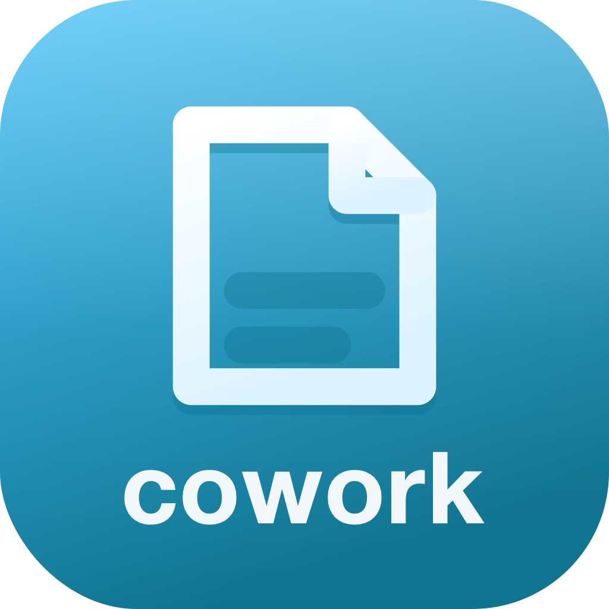
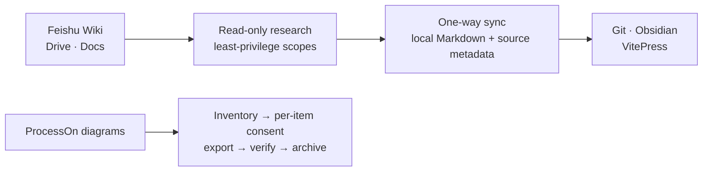
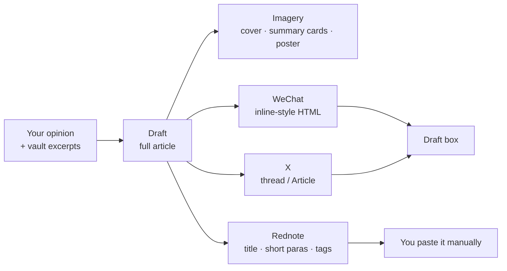

<div align="center">



# SOIA Open CWork Office Skills

**Office & Content: turn team material into local files, and opinions into per-platform drafts**

7 skills: read-only Feishu research with knowledge-base sync, ProcessOn diagram archiving; drafting, imagery and adaptation for WeChat / Rednote / X. Read-only and drafts-only by default; writes and publishing need your authorization

[中文](README.md) · English · [Ecosystem portal](https://github.com/soia-team/soia-open-skills)

<p align="center">
  
  
  
  
  
</p>

</div>

---

> **Since 2026-11-11**, the 5 `soia-media-*` skills from the former `soia-open-media-content-skills` repository live here. **Skill names are unchanged**, so installed copies, `~/.config/soia-skills/<skill-name>/` config and platform login profiles keep working. The former domain plugin `soia-media-content` is no longer updated; install `soia-cwork-office` instead.

## What it solves

**Office.** Material lives happily inside Feishu and ProcessOn — and **ceases to exist the moment you leave those platforms**. You can't search it, can't commit it, and your agent can't read it. What's missing is a compliant path that turns it into local files.



**Content.** You finish a piece, and then WeChat wants inline styles, Rednote wants short paragraphs with topic tags, X wants numbered parts — the same content reworked three times by hand. What's missing is **a pipeline from opinion to per-platform drafts**, not a bot that presses publish for you.



## 7 skills

### 01 Feishu　`Wiki and cloud docs → reviewable local Markdown`

| Skill | Responsibility | Ready |
|---|---|:-:|
| [`soia-cwork-feishu-cli`](https://github.com/soia-team/soia-open-skills/blob/main/docs/skills/soia-cwork-feishu-cli.md) | Read-only research across Wiki, Drive and docs via the official `lark-cli` with least-privilege scopes; **one-way** sync to local Markdown as an app identity, preserving structure, source links and sync metadata | 🟡 |

### 02 Diagrams　`ProcessOn diagrams → an archive whose completeness was verified`

| Skill | Responsibility | Ready |
|---|---|:-:|
| [`soia-cwork-processon-diagrams`](https://github.com/soia-team/soia-open-skills/blob/main/docs/skills/soia-cwork-processon-diagrams.md) | Inventories diagrams, exports the ones you authorize item by item, verifies completeness, then archives | 🟡 |

### 03 Drafting and imagery　`Opinion and material → a full draft plus visuals`

| Skill | Responsibility | Ready |
|---|---|:-:|
| [`soia-media-compose-article-draft`](https://github.com/soia-team/soia-open-skills/blob/main/docs/skills/soia-media-compose-article-draft.md) | Writes a full draft with your opinion as the spine and vault excerpts as material; WeChat / Zhihu / essay styles | ✅ |
| [`soia-media-generate-article-image`](https://github.com/soia-team/soia-open-skills/blob/main/docs/skills/soia-media-generate-article-image.md) | Covers, summary cards, Cornell-notes images and metaphor posters, with prompt provenance and bitmap acceptance | 🟡 |

### 04 Adaptation and drafts　`One draft → publish-ready on three platforms`

| Skill | Responsibility | Ready |
|---|---|:-:|
| [`soia-media-publish-wechat-draft`](https://github.com/soia-team/soia-open-skills/blob/main/docs/skills/soia-media-publish-wechat-draft.md) | Formats to WeChat-compliant inline-style HTML, mechanically validated before entering the draft box | 🟡 |
| [`soia-media-publish-rednote-card`](https://github.com/soia-team/soia-open-skills/blob/main/docs/skills/soia-media-publish-rednote-card.md) | Rewrites into a Rednote note: catchy title, 3–5 short paragraphs, topic tags, image suggestions | ✅ |
| [`soia-media-publish-x`](https://github.com/soia-team/soia-open-skills/blob/main/docs/skills/soia-media-publish-x.md) | Rewrites into a numbered, length-compliant X thread and saves a draft when authorized; or uploads a Markdown piece to the X Articles draft box and validates the format | 🟡 |

✅ Works right after install　🟡 Needs a platform login, app authorization or an API key first; the skill tells you what is missing before it runs

## Install

Any of three hosts. Installing the domain plugin brings all 7 skills at once.

Publishing and local installation are separate: the default is one skill for one project and one explicit host. Global, whole-domain or all-host scope requires an explicit choice and a dry-run first; publishing never syncs to local hosts automatically.

```bash
claude plugin marketplace add soia-team/soia-open-skills && claude plugin install soia-cwork-office@soia
```

```bash
codex plugin marketplace add soia-team/soia-open-skills && codex plugin add soia-cwork-office@soia
```

WorkBuddy is a desktop app with no CLI, so a skill does the work — tell your agent "install into WorkBuddy", or run:

```bash
python3 <soia-open-skills>/skills/soia-meta-skill-release/scripts/install_workbuddy_experts.py soia-cwork-office
```

Restart the client, then summon **Soia · 办公与内容助手** under Experts → My Experts.

> **Always-on cost ~1037 tok**. `claude plugin disable soia-cwork-office@soia` drops it to zero; enable it again any time.
> Single skill, project scope: `npx skills add soia-team/soia-open-cwork-office-skills -a <explicit-host> -s <skill-name>`; add `-g` only when you explicitly choose a global install. Pick this or the domain plugin, not both, so the index is not duplicated.

## What it does not do

Office side:

- **Read-only by default.** Writing, editing or deleting anything on a platform requires authorization **for that specific action** — a prior approval does not carry over.
- **Sync is one-way.** The local copy is a read-only mirror; editing it does not and should not push back.
- **Does not send company material anywhere.** Synced content stays local; nothing is uploaded to third-party services.
- **Does not install environments.** For `lark-cli` and browser-automation prerequisites, follow each tool's official documentation.

Content side:

- **Never publishes automatically.** WeChat gets a draft and **never a broadcast**; X gets a saved draft, never a post; Rednote gets text you paste yourself. This is a hard boundary — urgency does not move it, and blanket pre-authorization ("just stop asking me") is not accepted.
- **Does not write your opinions.** The skills organize expression; they do not manufacture a position. If you cannot articulate one, distill it first in the [vault domain](https://github.com/soia-team/soia-open-pkm-vault-skills).
- **Does not invent facts on images.** Before generating, it lists the facts that will appear and checks them with you.

Both sides:

- **Does not store credentials.** Feishu app credentials, ProcessOn sessions, and WeChat / X sessions and authorizations stay with the official flows and with you — never in the repo, the logs, or the output.

## Contributing

Before committing a skill change:

```bash
python3 -m unittest discover -s tests -p 'test_*.py' && python3 scripts/audit_skills.py --strict && python3 scripts/generate_expert_manifest.py --check
```

Full workflow in the portal's [CONTRIBUTING.md](https://github.com/soia-team/soia-open-skills/blob/main/CONTRIBUTING.md).

## License

MIT — see [LICENSE](./LICENSE). Third-party sources and license copies are in [THIRD_PARTY_NOTICES.md](./THIRD_PARTY_NOTICES.md) and `licenses/`.
