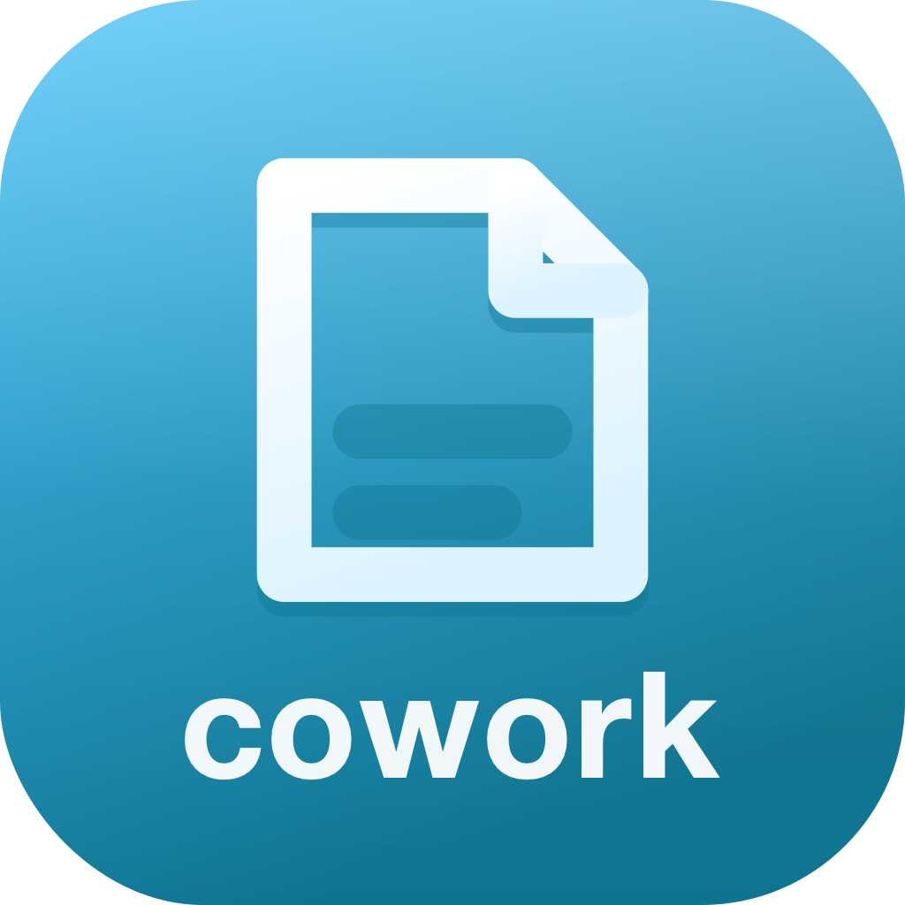
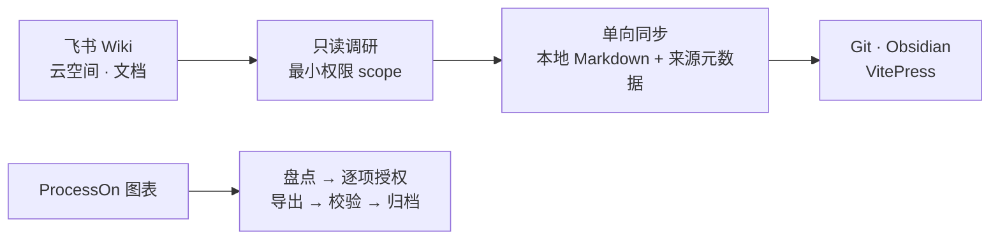
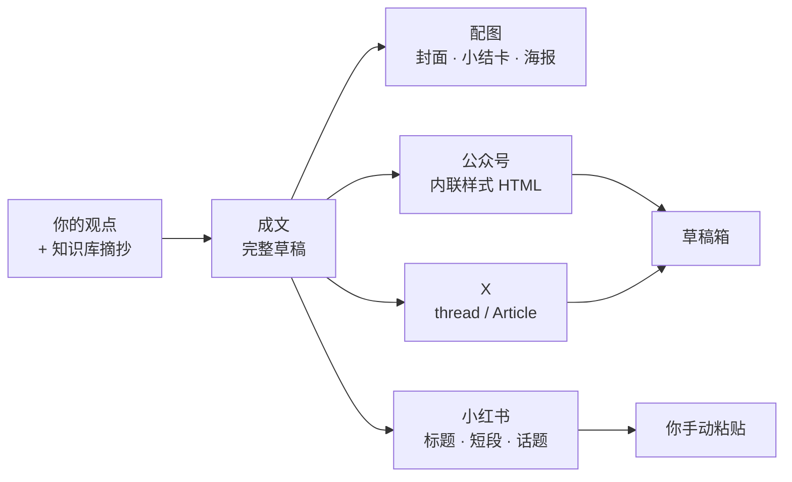

<div align="center">



# SOIA Open CWork Office Skills

**办公与内容：把团队资料落成本地文件，把观点做成各平台草稿**

7 个技能：飞书只读调研与知识库同步、ProcessOn 图表归档；成文、配图与公众号 / 小红书 / X 改写。默认只读、只建草稿，写操作与发布都由你授权

[English](README.en.md) · 中文 · [全生态门户](https://github.com/soia-team/soia-open-skills)

<p align="center">
  
  
  
  
  
</p>

</div>

---

> **2026-11-11 起**，原 `soia-open-media-content-skills` 仓的 5 个 `soia-media-*` 技能并入本仓，**技能名不变**，已装副本、`~/.config/soia-skills/<技能名>/` 配置与各平台登录 profile 不受影响。原域插件 `soia-media-content` 不再更新，改装 `soia-cwork-office`。

## 它解决什么

**办公**：资料在飞书和 ProcessOn 里活得很好，**离开那个平台就不存在**——搜不到、进不了 Git、AI 也读不着。缺的是一条把它们变成本地文件的合规通道。



**内容**：写完一篇，公众号要内联样式、小红书要短段加话题、X 要分条编号——同一份内容手工返工三遍。缺的是**一条从观点到各平台草稿的流水线**，而不是一个替你点发布的机器人。



## 7 个技能

### 01 飞书　`Wiki 与云文档 → 可复核的本地 Markdown`

| 技能 | 职责 | 开箱 |
|---|---|:-:|
| [`soia-cwork-feishu-cli`](https://github.com/soia-team/soia-open-skills/blob/main/docs/skills/soia-cwork-feishu-cli.md) | 通过官方 `lark-cli` 以最小权限只读调研 Wiki、Drive 与文档；以应用身份**单向**同步为本地 Markdown，保留目录、来源与同步元数据 | 🟡 |

### 02 图表　`ProcessOn 图表 → 校验过完整性的归档`

| 技能 | 职责 | 开箱 |
|---|---|:-:|
| [`soia-cwork-processon-diagrams`](https://github.com/soia-team/soia-open-skills/blob/main/docs/skills/soia-cwork-processon-diagrams.md) | 盘点图表，按逐项授权导出，校验完整性后归档 | 🟡 |

### 03 成文与配图　`观点与素材 → 成文草稿 + 视觉产物`

| 技能 | 职责 | 开箱 |
|---|---|:-:|
| [`soia-media-compose-article-draft`](https://github.com/soia-team/soia-open-skills/blob/main/docs/skills/soia-media-compose-article-draft.md) | 以你的观点为骨、vault 摘抄为料写成完整草稿；可指定公众号/知乎/随笔风格 | ✅ |
| [`soia-media-generate-article-image`](https://github.com/soia-team/soia-open-skills/blob/main/docs/skills/soia-media-generate-article-image.md) | 生成封面、正文小结卡、康奈尔笔记图或视觉隐喻海报，含 Prompt 落盘与位图验收 | 🟡 |

### 04 平台改写与落草稿　`一份成文 → 三平台可发状态`

| 技能 | 职责 | 开箱 |
|---|---|:-:|
| [`soia-media-publish-wechat-draft`](https://github.com/soia-team/soia-open-skills/blob/main/docs/skills/soia-media-publish-wechat-draft.md) | 排版成符合公众号限制的内联样式 HTML，机械校验通过后推入草稿箱 | 🟡 |
| [`soia-media-publish-rednote-card`](https://github.com/soia-team/soia-open-skills/blob/main/docs/skills/soia-media-publish-rednote-card.md) | 改写成小红书笔记：吸睛标题、3–5 段短文、话题标签与配图建议 | ✅ |
| [`soia-media-publish-x`](https://github.com/soia-team/soia-open-skills/blob/main/docs/skills/soia-media-publish-x.md) | 改写为带编号、符合字数限制的 X thread，可按授权存草稿；或把 Markdown 成文上传到 X Articles 草稿箱并校验格式 | 🟡 |

✅ 装完即用　🟡 需先完成对应平台的登录、应用授权或申请 API key，技能会在执行前告诉你缺什么

## 安装

三个宿主任选，装整个领域插件即 7 个技能一次到位。

发布与本机安装分开：默认按项目、明确宿主、单个技能定向安装；全局、整域或全宿主范围只有客户明确选择并先看 dry-run 后执行，发布不会自动同步到本机。

```bash
claude plugin marketplace add soia-team/soia-open-skills && claude plugin install soia-cwork-office@soia
```

```bash
codex plugin marketplace add soia-team/soia-open-skills && codex plugin add soia-cwork-office@soia
```

WorkBuddy 是桌面端没有 CLI，由技能代劳——对 AI 说「装到 WorkBuddy」，或直接跑：

```bash
python3 <soia-open-skills>/skills/soia-meta-skill-release/scripts/install_workbuddy_experts.py soia-cwork-office
```

装完重启客户端，在【专家中心 → 我的专家】召唤 **Soia · 办公与内容助手**。

> **常驻成本 ~1037 tok**。不用时 `claude plugin disable soia-cwork-office@soia` 降到零，随时开回来。
> 项目单技能：`npx skills add soia-team/soia-open-cwork-office-skills -a <明确宿主> -s <技能名>`；仅明确选择全局时加 `-g`。与域插件二选一，避免双份索引各自漂移。

## 不负责什么

办公侧：

- **默认只读**。写、改、删平台上的内容必须拿到**针对这一次**的明确授权，不因「上次批准过」就默认继续。
- **同步是单向的**。本地是平台的只读副本；改了本地不会也不该被推回去。
- **不外发公司资料**。同步下来的内容留在本地，不上传第三方服务。
- **不做环境安装**。`lark-cli`、浏览器自动化依赖的环境安装请按各工具官方文档。

内容侧：

- **绝不自动发布**。公众号只建草稿**绝不群发**；X 只存草稿不点发布；小红书只产文本由你手动贴。这是硬边界，催也不越线，也不接受「以后都不用问我」这类预授权。
- **不代写观点**。技能组织表达，不生产立场。说不出观点时先去 [知识库](https://github.com/soia-team/soia-open-pkm-vault-skills) 做提炼，而不是让 AI 替你编一个。
- **不编造图上的事实**。配图前先列事实清单跟你核对。

两侧共同：

- **不保存凭据**。飞书应用凭据、ProcessOn 登录态、公众号与 X 的登录态和授权由官方流程与你自己持有，不进仓库、不进日志、不写进产物。

## 贡献

改动技能后提交前跑：

```bash
python3 -m unittest discover -s tests -p 'test_*.py' && python3 scripts/audit_skills.py --strict && python3 scripts/generate_expert_manifest.py --check
```

完整流程见门户仓 [CONTRIBUTING.md](https://github.com/soia-team/soia-open-skills/blob/main/CONTRIBUTING.md)。

## License

MIT —— 见 [LICENSE](./LICENSE)。第三方来源与许可副本见 [THIRD_PARTY_NOTICES.md](./THIRD_PARTY_NOTICES.md) 与 `licenses/`。
